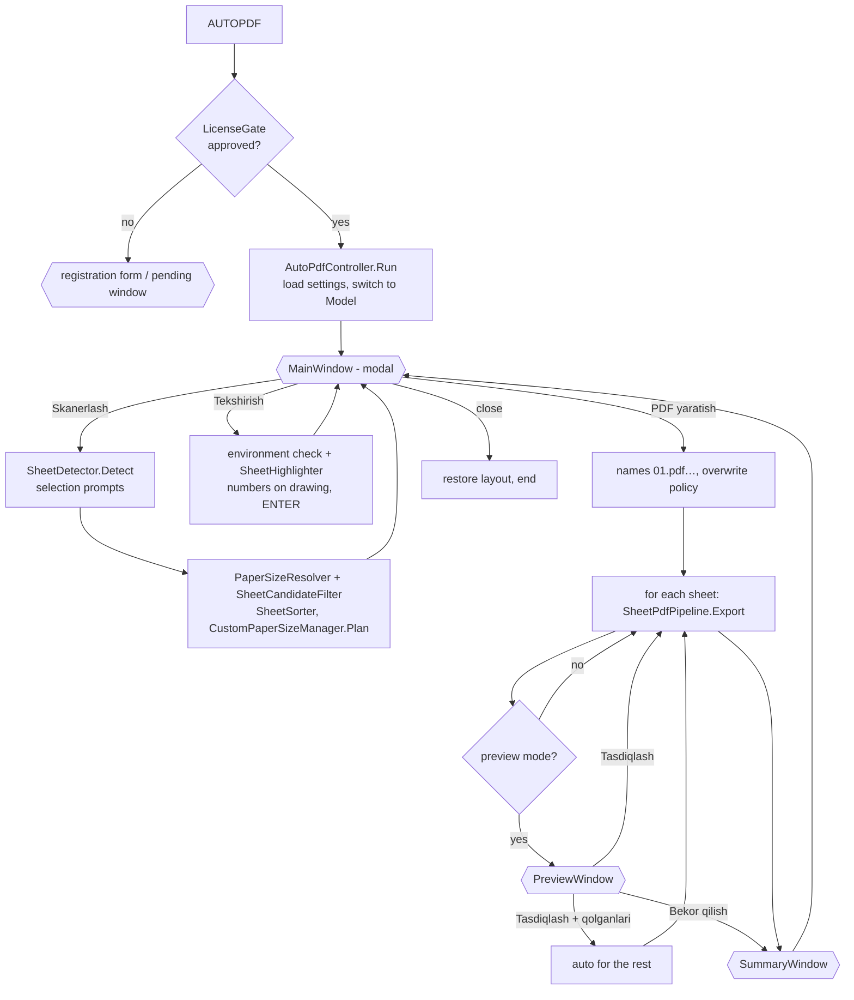

# Architecture

## Solution layout

```
AutoPDFPro.sln
├─ src/AutoPDF.Core        net48 + net8.0   no CAD references — all testable logic
│   ├─ Geometry/           Bounds2d, RectangleRecognizer
│   ├─ Paper/              PaperSize, PaperFormatCatalog (ISO + ГОСТ), PaperSizeResolver (scale + snapping)
│   ├─ Models/             SheetModel, SheetCandidateFilter, SheetResult, ExportSummary
│   ├─ Sorting/            SheetSorter
│   ├─ Plotting/           MediaSelector, PdfPageGeometry, PlotCommandBuilder (-PLOT answers),
│   │                      PlotRequest / PlotRunInfo / PlotStepException (host-neutral plot job)
│   ├─ Pdf/                PdfFileVerifier
│   ├─ Hosting/            HostInfo, CadBuildTarget, HostCatalog (release → year, build ↔ host check)
│   ├─ Licensing/          LicenseManager, HttpLicenseServer, LicenseToken, RsaPublicKey, LicenseStore,
│   │                      InstallationIdentity, LicenseConfig (see LICENSING.md)
│   ├─ Naming/             OutputFileNamer (01.pdf …)
│   ├─ Settings/           PluginSettings, SettingsService (XML in %APPDATA%\AutoPDFPro)
│   ├─ Logging/            LoggingService (%LOCALAPPDATA%\AutoPDFPro\Logs)
│   └─ Localization/L*.cs  every user-visible text in O‘zbekcha / Русский / English (+ AppInfo: author)
├─ src/AutoPDF.Pdf         net48 + net8.0   the shared per-sheet PDF pipeline
│   ├─ SheetPdfPipeline    plot → verify file → verify page → re-plot once if turned → crop → final check
│   ├─ PlotterContracts    ISheetPlotter, IMediaPlanner (implemented by each CAD host)
│   └─ PdfPageService      PdfSharp: read page box, crop
├─ src/AutoPDF.UI          net48 + net8.0-windows WPF, composed in C# (no XAML), no CAD references
│   ├─ Main/ Preview/ Settings/ Summary/ About/
│   ├─ Licensing/          RegistrationWindow, LicenseStatusWindow (+VMs), LicenseToast
│   └─ Services/           PdfPreviewRenderer (Windows.Data.Pdf), FolderPicker, MessageDialog, Shell
├─ src/AutoPDF.Cad         CAD-API source compiled into every host build (see COMPATIBILITY.md)
│   ├─ CadApi.cs           vendor namespaces: Autodesk.AutoCAD.* or ZwSoft.ZwCAD.* (#if ZWCAD)
│   ├─ AutoPdfApp.cs       IExtensionApplication (logging, dependency resolution, host check, licence timer)
│   ├─ Commands/           AutoPdfCommands: AUTOPDF, AUTOPDFLICENSE, AUTOPDFMEDIA, AUTOPDFLOG
│   ├─ Workflow/           AutoPdfController (main-window loop, scan/check/export, preview)
│   ├─ Detection/          SheetDetector, FrameReader
│   ├─ Plotting/           PlotService (API, ISheetPlotter), CommandLinePlotter (AutoCAD only),
│   │                      PlotSettingsService, CustomPaperSizeManager (IMediaPlanner), PageSetupService,
│   │                      PdfExportFactory (wires them into SheetPdfPipeline)
│   ├─ Licensing/          LicenseGate (AUTOPDF gate, background/periodic checks, notifications)
│   ├─ Transient/          SheetHighlighter (numbers drawn over the sheets, not in the DWG)
│   └─ Infrastructure/     HostEnvironment (detection, Esc), SysVarScope, EditorEcho, CadErrors
├─ src/AutoPDF.AutoCAD     host: AutoCAD 2021–2024 (net48, AutoCAD 2021 SDK)
├─ src/AutoPDF.AutoCAD.R25 host: AutoCAD 2025–2026 (net8.0-windows, AutoCAD 2025 SDK)
├─ src/AutoPDF.ZWCAD.2024 / .2025 / .2026   hosts: ZWCAD (net48, ZWCAD API of that year)
├─ server/licensing        Code.gs (Google Apps Script licence server) + Node tests
├─ tests/AutoPDF.Core.Tests xUnit (runs on any OS); fixtures/ test drawing for the in-CAD checklist
├─ tools/AutoPDF.UiDemo    shows the windows with sample data, without CAD (--demo register | pending | toast …)
├─ bundle/AutoPDFPro.bundle PackageContents.xml (template: R24 + R25 components)
├─ installer/              AutoPDFPro.nsi → Setup.exe (NSIS 3); nsis/ corrected Uzbek installer texts;
│                          art/ icon + wizard pictures (make_art.py); install.ps1/.bat, uninstall (zip)
└─ build/                  build.ps1 (build + test + zip + Setup.exe), build.sh (Linux/macOS)
```

Every host build stages its output: `artifacts\AutoPDFPro.bundle\Contents\Windows\R24|R25` (AutoCAD) and
`artifacts\ZWCAD\<year>` (ZWCAD); the installer packs these folders.

## Command flow



The main window is modal and **closes** for every action. Selection prompts, the plot engine and the
`-PLOT` fallback therefore always run in the plain command context, never from inside a WPF event handler
(the plot engine and `Editor.Command` require that).

## Per-sheet export pipeline (`SheetPdfPipeline`, shared by all hosts)

1. **prepare** – valid paper? output folder; existing file not locked (open in a PDF viewer) → deleted.
2. **media:select** – `CustomPaperSizeManager.Plan`:
   * exact full-bleed paper on the main plotter (`DWG To PDF.pc3`), same orientation (0°) or turned (90°);
   * exact paper on the optional *custom sizes* plotter (`AutoPDFPro PDF.pc3`, see
     [CUSTOM_PAPER_SIZES.md](CUSTOM_PAPER_SIZES.md));
   * otherwise the smallest full-bleed paper that holds the sheet → **crop** later.
3. **plot** – the host's `ISheetPlotter`: `PlotService` (PlotEngine): `PlotSettingsService.Create` (ordered
   steps, see ANALYSIS §1), `PlotInfoValidator`, engine begin/end with guaranteed clean-up. On failure
   (setting *Auto*) and on AutoCAD only → `CommandLinePlotter` (`-PLOT`).
4. **verify:file** – exists, > 0 bytes, `%PDF-` header, `%%EOF` trailer (waits up to 3 s for the driver).
5. **verify:page** – page size from the PDF (MediaBox + /Rotate). If width/height came out exchanged, the
   device places the drawing the other way round for that paper: the rotation is learned for that paper
   and the sheet is plotted once more.
6. **crop** (non-standard sizes only) – the plot is centred at the exact scale on full-bleed paper, so the
   sheet occupies the centred W×H box; MediaBox/CropBox are set to it (PdfSharp, via a temp file).
7. **verify:final-size** – final page vs. sheet paper (±1.5 mm, configurable).

Any exception becomes a `SheetResult { FailedStep, Error }`, logged as
`[List 03] [plot:engine-begin-document] eInvalidInput — …`. The loop continues with the next sheet unless
*Xatolik bo‘lganda: To‘xtatish* is set. ESC or *Cancel* in the plot progress dialog stops the batch.

## Paper-size detection

`PaperSizeResolver` converts the frame size (drawing units × INSUNITS factor) to millimetres for every
candidate scale (1, 2, 2.5, 4, 5, 10, … 1:10000, or only the fixed scale from the settings) and compares
with ISO A0–A5, ГОСТ extended formats and the user list. Among all matches within 0.5 mm the smallest
deviation wins; equal deviations prefer the smaller scale. Frames that match nothing get a custom paper
(rounded to 0.1 mm) at the scale whose short side is closest to a standard edge (if within 1 %), else the
smallest plausible scale. Sheets with a short side < 100 mm are not sheets (title-block cells).

## Localization

`L.Current` (O‘zbekcha / Русский / English) is set from `PluginSettings.Language` when `AUTOPDF` starts and
when the plug-in loads. Every text is a property or method of the static class `L` that returns the text of
the current language (`T(uz, ru, en)`), so a missing translation cannot compile and unit tests check that
every text exists in all three languages. Windows are built in code, therefore a language change simply
closes and rebuilds the main window (`MainAction.Reload`). Step names in the log (`plot:set-media` …) stay
English so logs are comparable across languages.

## Licensing

`AutoPdfController.Run` starts with `LicenseGate.EnsureLicensed`: registration form on the first run, the
persistent status window while pending/rejected, and a background re-check when already approved. The rules
(signed approvals, offline grace, throttling) live in `AutoPDF.Core.Licensing.LicenseManager`; the server is
`server/licensing/Code.gs`. See [LICENSING.md](LICENSING.md).

## Why these technical choices

| Choice | Reason |
|---|---|
| Plot API (PlotEngine) as primary | Language-independent, no prompt sequences, precise errors. |
| In-memory `PlotSettings` override | Never changes the user's page setups or layouts. |
| Crop instead of writing PC3/PMP | AutoCAD has no API to add paper sizes; hand-writing PC3/PMP binaries risks breaking the user's plotters. Crop needs nothing but standard papers. An exact custom plotter is used when the user provides one. |
| Orientation self-check | The meaning of PlotRotation relative to a paper's native orientation is device-specific; measuring the result makes it deterministic. |
| WPF built in C# | Compiler-checked bindings/styles, no runtime XAML parse errors inside AutoCAD, buildable on CI. |
| Windows.Data.Pdf for preview | Built into Windows 10/11: no native PDF DLL to ship (the .NET 8 build carries the Windows SDK projection). The file is read into memory, so it is never locked. |
| PdfSharp 1.50.5147 | MIT, single managed DLL, the version the previous plug-in already loaded in AutoCAD 2024; on .NET 8 the code-page provider is registered for it. |
| One source, several host builds | AutoCAD R24, R25 and each ZWCAD release need assemblies compiled against their own SDK/runtime; `CadApi.cs` keeps the vendor difference in one place, the PDF logic is shared in `AutoPDF.Pdf`. |
| NSIS for Setup.exe | One file (≈ 4 MB) for every host, with an uninstaller; compiles on Windows and Linux (CI); Unicode wizard in O‘zbekcha / Русский / English. |
| Apps Script + Google Sheet for licensing | E-mail, storage and signing run in the administrator's own Google account, so no password, SMTP or signing secret ships in the plug-in; the client only holds the public web-app URL and verifies signatures with the public key. |
| Distinct assembly names (`AutoPDF.*`) | Cannot collide with the old `AutoPDFPro.*` assemblies if both bundles are present during migration. |
