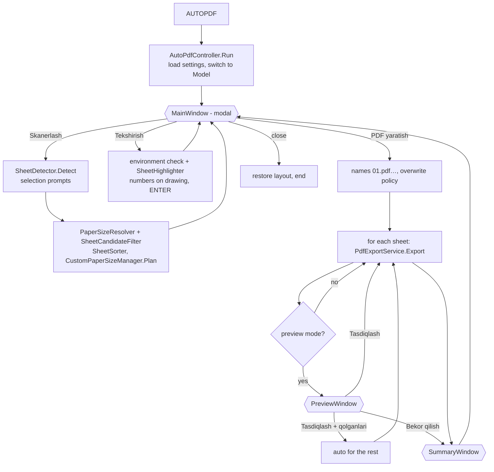

# Architecture

## Solution layout

```
AutoPDFPro.sln
├─ src/AutoPDF.Core        net48 + net8.0   no AutoCAD references — all testable logic
│   ├─ Geometry/           Bounds2d, RectangleRecognizer
│   ├─ Paper/              PaperSize, PaperFormatCatalog (ISO + ГОСТ), PaperSizeResolver (scale + snapping)
│   ├─ Models/             SheetModel, SheetCandidateFilter, SheetResult, ExportSummary
│   ├─ Sorting/            SheetSorter
│   ├─ Plotting/           MediaSelector, PdfPageGeometry (crop/orientation), PlotCommandBuilder (-PLOT answers)
│   ├─ Pdf/                PdfFileVerifier
│   ├─ Naming/             OutputFileNamer (01.pdf …)
│   ├─ Settings/           PluginSettings, SettingsService (XML in %APPDATA%\AutoPDFPro)
│   ├─ Logging/            LoggingService (%LOCALAPPDATA%\AutoPDFPro\Logs)
│   ├─ Registration/       RegistrationConfig, RegistrationInfo + Store, MachineFacts, HttpRegistrationGateway
│   └─ Localization/L*.cs  every user-visible text in O‘zbekcha / Русский / English (+ AppInfo: author)
├─ src/AutoPDF.UI          net48 WPF, composed in C# (no XAML), no AutoCAD references
│   ├─ Main/               MainWindow, MainViewModel, SheetRowViewModel
│   ├─ Preview/            PreviewWindow (+VM), Cancel / Confirm / Confirm-all
│   ├─ Settings/           SettingsWindow (+VM)
│   ├─ Summary/            SummaryWindow
│   ├─ About/              AboutWindow, AuthorInfo (embedded photo Assets/author.jpg, round avatar)
│   ├─ Registration/       RegistrationWindow (+VM), UsersWindow (+VM, admin)
│   └─ Services/           PdfPreviewRenderer (Windows.Data.Pdf), FolderPicker, MessageDialog, Shell
├─ src/AutoPDF.AutoCAD     net48 x64 — the plug-in loaded by AutoCAD 2024
│   ├─ AutoPdfApp.cs       IExtensionApplication (logging, dependency resolution)
│   ├─ Commands/           AutoPdfCommands: AUTOPDF, AUTOPDFMEDIA, AUTOPDFLOG, AUTOPDFADMIN
│   ├─ Workflow/           AutoPdfController (main-window loop, scan/check/export, preview)
│   ├─ Detection/          SheetDetector, FrameReader
│   ├─ Plotting/           PlotSettingsService, PlotService, CommandLinePlotter,
│   │                      CustomPaperSizeManager, PageSetupService, PdfExportService
│   ├─ Pdf/                PdfPageService (PdfSharp: read page box, crop)
│   ├─ Transient/          SheetHighlighter (numbers drawn over the sheets, not in the DWG)
│   └─ Infrastructure/     PlotStepException, SysVarScope, EditorEcho, AcadErrors
├─ tests/AutoPDF.Core.Tests xUnit (runs on any OS)
├─ tools/AutoPDF.UiDemo    shows the windows with sample data, without AutoCAD (--demo register | users)
├─ bundle/AutoPDFPro.bundle PackageContents.xml (template)
├─ installer/              AutoPDFPro.nsi → Setup.exe (NSIS 3); nsis/ corrected Uzbek installer texts;
│                          art/ icon + wizard pictures (make_art.py); registration/ Apps Script back end;
│                          install.ps1/.bat, uninstall (zip)
└─ build/                  build.ps1 (build + test + zip + Setup.exe), build.sh (Linux/macOS)
```

Every build of `AutoPDF.AutoCAD` assembles `artifacts\AutoPDFPro.bundle` (manifest + 4 DLLs).

## Command flow



The main window is modal and **closes** for every action. Selection prompts, the plot engine and the
`-PLOT` fallback therefore always run in the plain command context, never from inside a WPF event handler
(the plot engine and `Editor.Command` require that).

## Per-sheet export pipeline (`PdfExportService`)

1. **prepare** – valid paper? output folder; existing file not locked (open in a PDF viewer) → deleted.
2. **media:select** – `CustomPaperSizeManager.Plan`:
   * exact full-bleed paper on the main plotter (`DWG To PDF.pc3`), same orientation (0°) or turned (90°);
   * exact paper on the optional *custom sizes* plotter (`AutoPDFPro PDF.pc3`, see
     [CUSTOM_PAPER_SIZES.md](CUSTOM_PAPER_SIZES.md));
   * otherwise the smallest full-bleed paper that holds the sheet → **crop** later.
3. **plot** – `PlotService` (PlotEngine): `PlotSettingsService.Create` (ordered steps, see ANALYSIS §1),
   `PlotInfoValidator`, engine begin/end with guaranteed clean-up. On failure (setting *Auto*) →
   `CommandLinePlotter` (`-PLOT`).
4. **verify:file** – exists, > 0 bytes, `%PDF-` header, `%%EOF` trailer (waits up to 3 s for the driver).
5. **verify:page** – page size from the PDF (MediaBox + /Rotate). If width/height came out exchanged, the
   device places the drawing the other way round for that paper: the rotation is learned for that paper
   and the sheet is plotted once more.
6. **crop** (non-standard sizes only) – the plot is centred at the exact scale on full-bleed paper, so the
   sheet occupies the centred W×H box; MediaBox/CropBox are set to it (PdfSharp, via a temp file).
7. **verify:final-size** – final page vs. sheet paper (±1.5 mm, configurable).

Any exception becomes a `SheetResult { FailedStep, Error }`, logged as
`[List 03] [plot:engine-begin-document] eInvalidInput — …`. The loop continues with the next sheet unless
*Xatolik bo‘lganda: To‘xtatish* is set. ESC or *Cancel* in the plot progress dialog stops the batch.

## Paper-size detection

`PaperSizeResolver` converts the frame size (drawing units × INSUNITS factor) to millimetres for every
candidate scale (1, 2, 2.5, 4, 5, 10, … 1:10000, or only the fixed scale from the settings) and compares
with ISO A0–A5, ГОСТ extended formats and the user list. Among all matches within 0.5 mm the smallest
deviation wins; equal deviations prefer the smaller scale. Frames that match nothing get a custom paper
(rounded to 0.1 mm) at the scale whose short side is closest to a standard edge (if within 1 %), else the
smallest plausible scale. Sheets with a short side < 100 mm are not sheets (title-block cells).

## Localization

`L.Current` (O‘zbekcha / Русский / English) is set from `PluginSettings.Language` when `AUTOPDF` starts and
when the plug-in loads. Every text is a property or method of the static class `L` that returns the text of
the current language (`T(uz, ru, en)`), so a missing translation cannot compile and unit tests check that
every text exists in all three languages. Windows are built in code, therefore a language change simply
closes and rebuilds the main window (`MainAction.Reload`). Step names in the log (`plot:set-media` …) stay
English so logs are comparable across languages.

## Registration

Optional and configured by the author. `RegistrationConfig.Endpoint` holds a Google Apps Script web-app URL;
while it is the placeholder the whole feature is off (`IsConfigured == false`) and the plug-in is unchanged.

At the start of `AutoPdfController.Run`, `EnsureRegistered()`:

1. loads `%APPDATA%\AutoPDFPro\registration.xml` (`RegistrationStore`); if the machine has already
   registered, it returns immediately (and quietly re-sends in the background if a previous send never
   reached the server);
2. otherwise shows `RegistrationWindow`. The user types name + e-mail (+ optional phone), sees the exact
   facts that will leave the machine (`MachineFacts`: computer, Windows user, version), ticks consent and
   presses Register;
3. `HttpRegistrationGateway.Submit` POSTs the form to the web app (`Code.gs`), which — running inside the
   author's Google account — e-mails the author and appends the user to a Google Sheet. On success the
   registration is stored as delivered; on a network failure the user may continue and it is re-sent later.

`AUTOPDFADMIN` reads the list back: `HttpRegistrationGateway.FetchUsers(adminKey)` (a GET whose reply is one
`OK` line plus tab-separated rows) fills `UsersWindow`. The admin key is checked on the server and typed by
the author, so it is never part of the distributed plug-in. All of `Registration/` lives in `AutoPDF.Core`
with no AutoCAD dependency, so the gateway is unit-tested against a local `HttpListener`.

## Why these technical choices

| Choice | Reason |
|---|---|
| Plot API (PlotEngine) as primary | Language-independent, no prompt sequences, precise errors. |
| In-memory `PlotSettings` override | Never changes the user's page setups or layouts. |
| Crop instead of writing PC3/PMP | AutoCAD has no API to add paper sizes; hand-writing PC3/PMP binaries risks breaking the user's plotters. Crop needs nothing but standard papers. An exact custom plotter is used when the user provides one. |
| Orientation self-check | The meaning of PlotRotation relative to a paper's native orientation is device-specific; measuring the result makes it deterministic. |
| WPF built in C# | Compiler-checked bindings/styles, no runtime XAML parse errors inside AutoCAD, buildable on CI. |
| Windows.Data.Pdf for preview | Built into Windows 10/11 (AutoCAD 2024's platforms): no native PDF DLL to ship. The file is read into memory, so it is never locked. |
| PdfSharp 1.50.5147 | MIT, single managed DLL, the version the previous plug-in already loaded in AutoCAD 2024. |
| NSIS for Setup.exe | One small file (≈ 0.5 MB) with an uninstaller; compiles on Windows and Linux (CI); Unicode wizard in O‘zbekcha / Русский / English. |
| Apps Script for registration | E-mail + storage run in the author's own Google account, so no password or SMTP secret ships in the plug-in; the client only holds a public web-app URL and never sees the user's Google password. |
| Distinct assembly names (`AutoPDF.*`) | Cannot collide with the old `AutoPDFPro.*` assemblies if both bundles are present during migration. |
